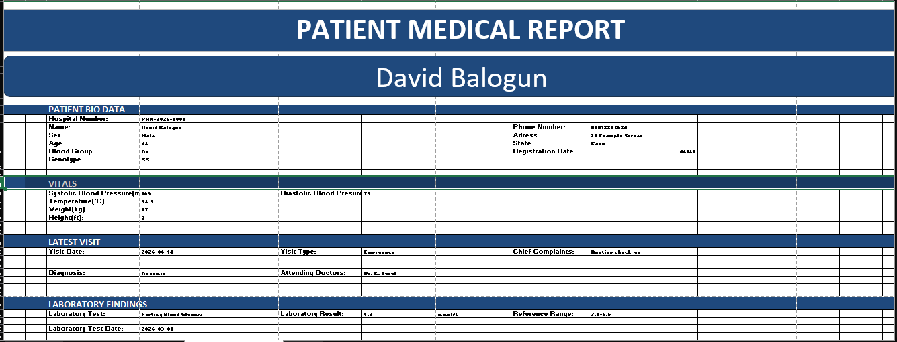

# 🏥 Excel Patient Record Automation

> **From raw tables to a one-click patient report.**
> Pick a Hospital Number from a dropdown and a formatted *Patient Medical Report* builds itself: bio data, vitals, latest visit and lab findings.


---

## 📑 Table of Contents
1. [Project Preview](#-project-preview)
2. [Introduction](#-introduction)
3. [Intention: Automation over Analysis](#-intention-automation-over-analysis)
4. [Data Overview](#-data-overview)
5. [Methodology](#-methodology)
6. [How to Navigate](#-how-to-navigate)
7. [Key Features](#-key-features)
8. [Repository Structure](#-repository-structure)
9. [Known Limitations and Roadmap](#-known-limitations-and-roadmap)
10. [Skills Demonstrated](#-skills-demonstrated)
11. [Disclaimer](#-disclaimer)
12. [Author](#-author)

---

## 🖼 Project Preview



*The automated Patient Medical Report. Every value below the patient's name is pulled from the database sheets by formula.*

---

## 📖 Introduction

Hospital records usually live in separate lists: one for patient details, one for visits, one for laboratory results. Finding everything about a single patient means scrolling through each list and matching the Hospital Number by eye. That is slow and easy to get wrong.

This project connects three linked tables (patients, visits, lab results) to a single, print-ready **Patient Medical Report** sheet in Microsoft Excel. The user selects a Hospital Number and the whole report updates instantly. No macros, no VBA, no manual copy-and-paste.

I built it as part of my data analytics training. I come from a medical background, so I wanted to show how everyday spreadsheet skills can solve a real clinical-records problem.

---

## 🎯 Intention: Automation over Analysis

Most beginner data projects stop at analysis: clean the data, make charts, report a few findings.

**This project goes one step further.** Instead of only *analysing* a dataset, I built an **automation report**: a reusable tool that turns a database into a finished document on demand.

| Typical analysis project | This automation project |
|---|---|
| Answers a question once | Answers the same question for *any* patient, every time |
| Output is a static chart or summary | Output is a live, self-updating report |
| Needs the analyst to re-run the work | Anyone can use it by choosing from a dropdown |
| Insight stays with the analyst | The tool stays with the user |

The goal is to save time, reduce lookup errors, and make patient information easy to read.

---

## 📊 Data Overview

> ⚠️ **All data is synthetic.** It was generated for learning and portfolio purposes and contains no real patient information.

The workbook contains three related tables, joined by **Hospital Number** (the key shared by all three):

| Table | Sheet | Records | What it holds |
|---|---|---|---|
| **Patient Record** | `Patient Record` | 30 patients | Hospital Number, name, sex, date of birth, blood group, genotype, phone, address, state, registration date, calculated age |
| **Visits** | `Visits` | 45 visits | Visit number, visit date, chief complaint, diagnosis, systolic and diastolic BP, temperature, attending doctor, visit type, age, weight (kg), height (ft) |
| **Lab Results** | `Lab Results` | 60 results | Lab ID, test date, test name, result, unit, reference range |

**Coverage of the sample data**

- **Patients:** 16 male, 14 female, across 6 states (Kano, Kwara, Kaduna, Lagos, Abuja FCT, Oyo)
- **Visits:** January to August 2026, split into Emergency (17), Follow-up (15) and Outpatient (13)
- **Diagnoses (10):** Anaemia, Urinary tract infection, Malaria, Type 2 diabetes, Hypertension, Gastritis, Peptic ulcer disease, Migraine, Upper respiratory tract infection, Routine medical review
- **Lab tests (5):** Platelets, Creatinine, WBC, Fasting Blood Glucose, PCV

**Two versions of the file are included**

| File | Purpose |
|---|---|
| `data/Excel_Automated_Patient_Record_dataset_raw.xlsx` | The starting point: three plain data sheets plus a *How to Use* sheet |
| `workbook/Excel_Automated_Patient_Report_Dataset.xlsx` | The finished product: formatted tables, added columns, dropdown and the automated `Patients Report` sheet |

---

## 🛠 Methodology

The build followed five steps.

### 1. Prepare the data
- Started from the raw dataset (three flat sheets).
- Converted each range into an **Excel Table** (`Table1`, `Table2`, `Table3`) so ranges stay structured and are easy to extend.
- Added helper columns:
  - **Age (years)** on the patient sheet, derived from date of birth.
  - **Weight (kg)** and **Height (ft)** on the visits sheet, to fill the *Vitals* section of the report.

### 2. Create the selector
- Added a **Data Validation dropdown** in cell `D6` of the report sheet.
- The list source is the Hospital Number column of the Patient Record sheet, so the user picks a valid ID instead of typing one from memory.

### 3. Link the tables with `XLOOKUP`
Each field on the report is a lookup keyed on the selected Hospital Number.

```excel
=XLOOKUP(D6, 'Patient Record'!$A:$A, 'Patient Record'!$B:$B, FALSE)
```

| Lookup value | Lookup column | Return column |
|---|---|---|
| Selected Hospital Number (`D6`) | Hospital Number | Name, Sex, Age, Blood Group, Genotype, Phone, Address, State, Registration Date |
| Selected Hospital Number (`D6`) | Hospital Number | Visit date and type, complaint, diagnosis, doctor, BP, temperature, weight, height |
| Selected Hospital Number (`D6`) | Hospital Number | Lab test, result, unit, reference range, test date |

`XLOOKUP` was chosen over `VLOOKUP` because it looks up by column rather than column index, so it does not break when columns move, and it returns a clear fallback value when nothing is found.

### 4. Design the report layout
- Built the `Patients Report` sheet as a document rather than a table: title banner, patient-name banner and four colour-coded sections.
  - **Patient Bio Data**
  - **Vitals**
  - **Latest Visit**
  - **Laboratory Findings**
- Applied a consistent navy theme with clear section headers, and laid the sheet out in page-width blocks so it prints as a single report.

### 5. Document
- Added a **How to Use** sheet so a first-time user can operate the workbook without help.
- Recorded a screen walkthrough (below).

---

## 🧭 How to Navigate

### 🎥 Video walkthrough

[▶ Watch the walkthrough video](assets/navigation_demo.mp4)

> 💡 **GitHub tip:** to get an inline video player, edit this README on github.com, drag `assets/navigation_demo.mp4` into the editor, and GitHub will insert a player link. Then delete the line above.

### Step by step

1. **Download** `workbook/Excel_Automated_Patient_Report_Dataset.xlsx` and open it in **Microsoft Excel 365 or Excel 2021+** (`XLOOKUP` is required).
2. Open the **`How to Use`** sheet for a quick guide.
3. Go to the **`Patients Report`** sheet.
4. Click cell **`D6`** and choose a **Hospital Number** from the dropdown (e.g. `PHN-2026-0008`).
5. The report fills in automatically:
   - **Patient Bio Data**: name, sex, age, blood group, genotype, phone, address, state, registration date
   - **Vitals**: blood pressure, temperature, weight, height
   - **Latest Visit**: date, type, complaint, diagnosis, attending doctor
   - **Laboratory Findings**: test, result, unit, reference range, date
6. Press **Ctrl + P** to print or save the report as a PDF.

### Adding new patients
1. Add a row to the **Patient Record** table (and matching rows in **Visits** and **Lab Results**).
2. Excel Tables expand automatically. If the dropdown does not pick up the new ID, extend its source range.

### Workbook map

| Sheet | Role |
|---|---|
| `How to Use` | Instructions |
| `Patient Record` | Patient master table |
| `Visits` | Visit history table |
| `Lab Results` | Laboratory results table |
| `Patients Report` | **The automated report** (the only sheet users need to touch) |

---

## ✨ Key Features

- ✅ One-click report generation from a dropdown
- ✅ Three relational tables linked by a shared key
- ✅ No macros or VBA, only native Excel formulas
- ✅ Print-ready, professionally formatted layout
- ✅ Scalable: add rows and the report keeps working
- ✅ Fully synthetic, privacy-safe data

---

## 🗂 Repository Structure

```
📦 excel-patient-record-automation
 ┣ 📂 assets
 ┃ ┣ 🖼 patient_report_preview.png
 ┃ ┗ 🎥 navigation_demo.mp4
 ┣ 📂 data
 ┃ ┗ 📄 Excel_Automated_Patient_Record_dataset_raw.xlsx
 ┣ 📂 workbook
 ┃ ┗ 📄 Excel_Automated_Patient_Report_Dataset.xlsx
 ┗ 📄 README.md
```

---

## 🚧 Known Limitations and Roadmap

This is a learning and portfolio template, so I have listed what I plan to improve:

- [ ] **Latest visit logic:** return the most recent visit and lab result per patient (currently the first match is returned). Planned approach: `MAXIFS` on visit date, or sorting by date and searching last-to-first.
- [ ] **Lookup alignment:** make every visit and vitals formula look up against the `Visits` sheet's own Hospital Number column, so each value always comes from that patient's visit record.
- [ ] **Static height values:** replace the randomly generated height placeholder with fixed values so reports do not change on recalculation.
- [ ] **Show all lab tests** per patient, not just one.
- [ ] Format the registration date and fix label typos in the report template.
- [ ] Add a summary dashboard (visits by diagnosis, lab trends) using PivotTables and charts.
- [ ] Add flagging for abnormal lab values against their reference ranges.

---

## 🧰 Skills Demonstrated

`Microsoft Excel` · `XLOOKUP` · `Data Validation` · `Excel Tables` · `Relational data modelling` · `Report design` · `Data cleaning` · `Process automation` · `Healthcare data` · `Technical documentation`

---

## ⚠️ Disclaimer

This workbook is a **learning and portfolio template**, not a clinical records system. All patient names, numbers and results are **synthetic** and must not be used for any real medical decision. It does not meet the security and privacy requirements for storing real patient data.

---

## 👩🏽‍⚕️ Author

**Adeniyi Aishat Himisioluwa**
Medical student, University of Ilorin · Data Analytics Fellow

Interested in bridging healthcare and technology.

📫 Connect with me: [LinkedIn](https://www.linkedin.com/in/aishat-adeniyi-2b1a40264?utm_source=share&utm_campaign=share_via&utm_content=profile&utm_medium=android_app) · [GitHub](https://github.com/Himisigold03)
⭐ *If you found this useful, consider giving the repo a star!*
